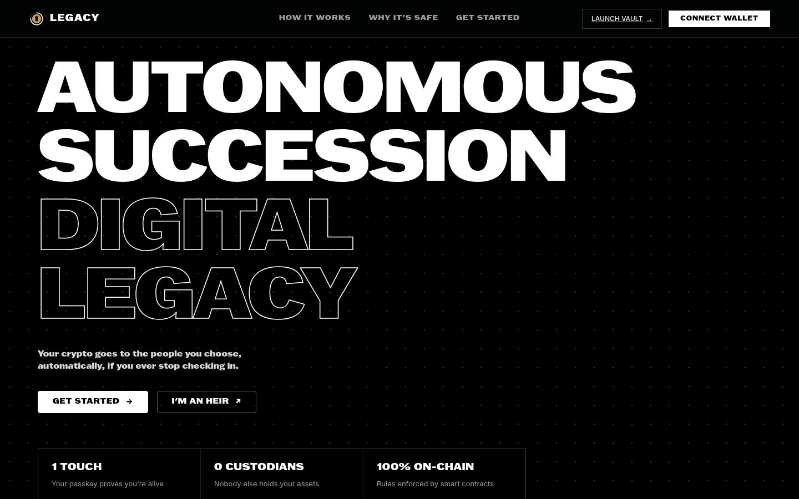
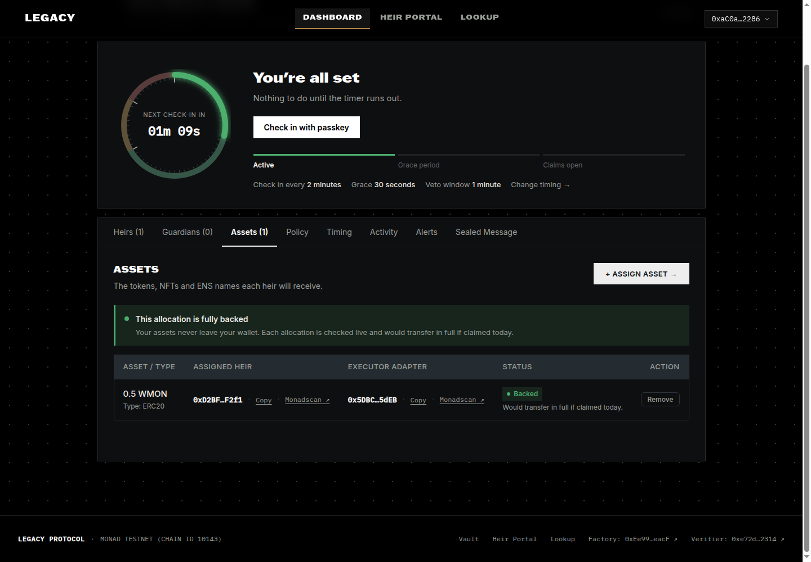
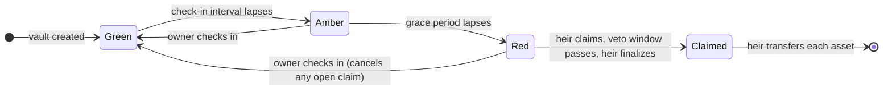
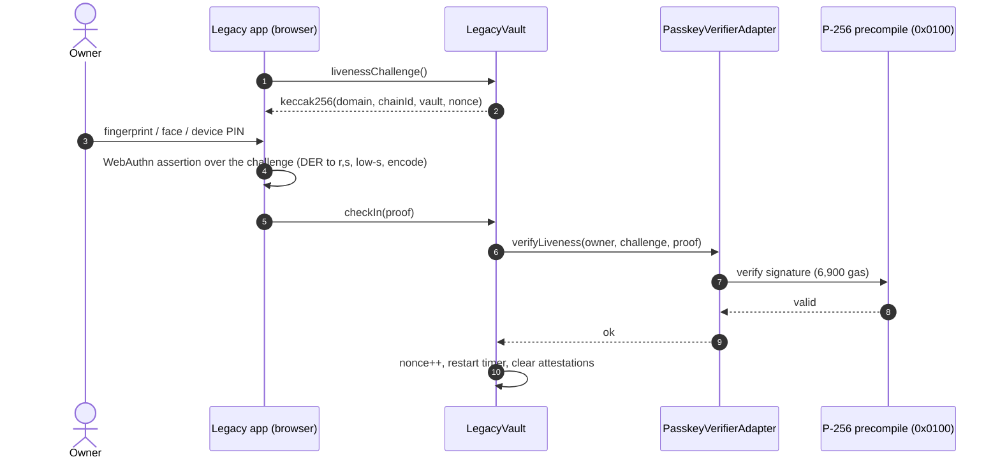
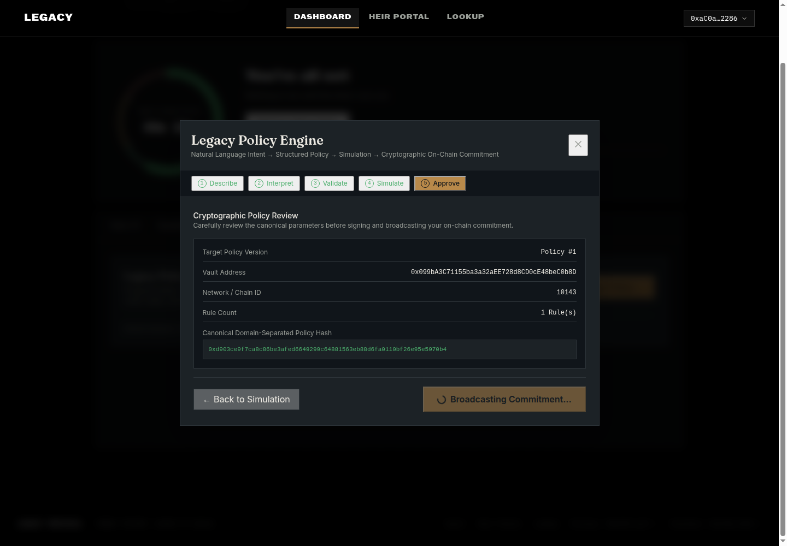
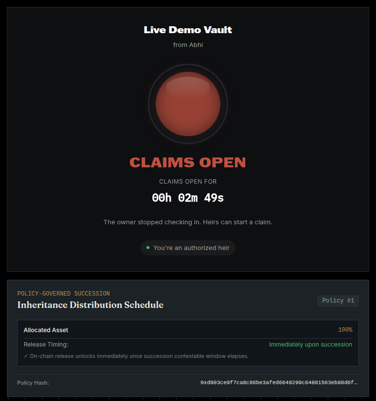
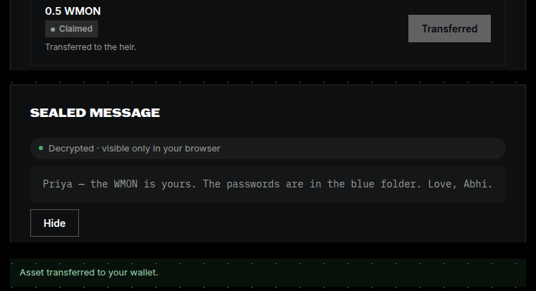
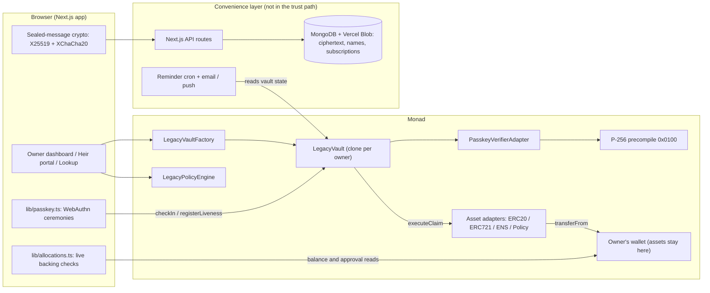

<div align="center">

<h1>
  <picture>
    <source media="(prefers-color-scheme: dark)" srcset="legacy-frontend/public/brand/logo-lockup-on-dark.svg">
    
  </picture>
</h1>

**Passkey-native, zero-custody crypto inheritance on Monad.**

*A bank vault, not a dashboard.*

[](https://github.com/yashvikram30/legacy/actions/workflows/test.yml)


[](LICENSE)

**[Live app](https://legacy-drab-two.vercel.app)** · **[Contracts on Monadscan](https://testnet.monadscan.com/address/0xEe99BE33c48C1362e66fb3db773018Db1cC1eacF)** · **[Live end-to-end run](#live-end-to-end-run)** · Monad Metropolis · Track 4: Trust, Identity & AI Infrastructure



</div>

---

Your assets never leave your wallet. You prove you're alive with your fingerprint or face — a passkey, verified fully on-chain through Monad's P-256 precompile. If you stop checking in, the heirs you named can claim exactly what you left them. No seed phrase, no custodian, no lawyer, and no oracle or server anywhere in the liveness and inheritance path.

## Contents

- [The problem](#the-problem)
- [What makes Legacy different](#what-makes-legacy-different)
- [How it works](#how-it-works)
- [Features](#features)
- [Why Monad](#why-monad)
- [Live on Monad testnet](#live-on-monad-testnet)
- [Architecture](#architecture)
- [Security model](#security-model)
- [Testing](#testing)
- [Getting started](#getting-started)
- [Deploying your own](#deploying-your-own)
- [Configuration](#configuration)
- [Project structure](#project-structure)
- [Roadmap](#roadmap)
- [License](#license)

---

## The problem

When a crypto holder dies, their assets usually die with their keys. Billions in crypto are already unrecoverable for exactly this reason. The options today are poor:

- **Share your seed phrase** with family or a lawyer — and trust them with everything, today.
- **Use a custodial service** — a company holds your keys or your funds, and you depend on it surviving you.
- **Use an on-chain "dead man's switch"** — almost every one makes you *deposit* your assets into its contract, creating a honeypot, and most prove liveness through a third party (an oracle, an identity provider, a keeper network).

## What makes Legacy different

| | |
| :--- | :--- |
| 🔐 **Zero custody** | A vault never holds your assets. Each allocation is a standing permission; at claim time an adapter moves the asset straight from your wallet to your heir. You keep using your assets normally, and there is no pooled honeypot to attack. |
| ✅ **Proof that it will pay out** | Because assets stay in your wallet, an allocation could silently stop being funded if you spend the tokens or revoke an approval. Legacy checks every allocation live and shows owners, heirs and the public whether it would transfer in full **today** — and flips to *Underfunded* within seconds if it wouldn't. |
| 👆 **Passkey liveness, no third party** | Check-ins are WebAuthn passkey assertions — fingerprint, face or device PIN — verified on-chain by OpenZeppelin's audited WebAuthn library and Monad's P-256 precompile. No seed phrase, no identity provider, no oracle, no signing server. |

<p align="center"></p>

## How it works

Every vault moves through three states, computed on-chain from the time of the owner's last check-in — no transaction or keeper is needed to advance it.



| State | Meaning |
| :--- | :--- |
| 🟢 **Green** | The owner checked in recently. Only the owner can act. |
| 🟡 **Amber** | The check-in interval lapsed. A grace period runs before heirs can act. |
| 🔴 **Red** | The grace period expired. Heirs may open a claim — which still waits out a veto window the owner can use to cancel it. |

**As the owner**
1. Create a vault and set up a passkey on your device.
2. Add heirs, and assign assets to each — MON, any ERC-20, or NFTs through an executor adapter.
3. Optionally write an inheritance policy in plain language, name guardians, and seal a private message for each heir.
4. Check in with your passkey on your own schedule. If a claim is ever opened while you're alive, one check-in cancels it.

**As an heir**
1. See what you're set to receive — and whether it's still backed — at any time.
2. Once the vault is Red, open a claim, wait out the veto window, finalize, and transfer.
3. Open the sealed message the owner left you.

### A passkey check-in, end to end



The challenge is single-use and bound to the chain, the vault and a nonce, so every assertion can be used exactly once — never replayed later, on another vault, or on another chain.

## Features

### Passkey check-ins, verified on-chain
- Setup binds a passkey's P-256 public key to the vault and proves possession by signing the vault's current challenge. Registration also counts as a check-in.
- Every check-in is a fresh WebAuthn assertion over the next challenge. **User verification is required** — a biometric or device PIN, not just a tap.
- Works with platform passkeys (Touch ID, Face ID, Windows Hello, Android), synced passkeys (iCloud Keychain, Google Password Manager) and password managers — including ones that don't implement `getPublicKey()`, via a CBOR attestation fallback.
- Browsers return high-s signatures about half the time; the app normalises them to the low-s form the contract requires.

### Zero-custody inheritance with live backing checks
- Allocations are approvals to per-asset adapters (`ERC20Adapter`, `ERC721Adapter`, `ENSResolverAdapter`), never deposits.
- Every allocation is checked live: **Backed**, **Underfunded** (with how much you hold), **Approval missing** (with one-click re-approve), or **Not held**.
- Owners see a readiness banner on the dashboard; heirs see the same answer before any claim exists; anyone can see it on the public lookup page.

### Native MON
MON is wrapped 1:1 into WMON in the owner's own wallet — native balances can't be approved — and then allocated like any token. A small reserve is kept back for gas.

### Inheritance policies and the AI will compiler
<p align="center"></p>

Describe your wishes in plain language — *"give Priya 60% of my WMON now and 40% after a year"*. The compiler (Gemini or OpenAI when configured, otherwise a built-in deterministic compiler) turns it into a structured policy: beneficiaries, percentage splits, release delays and fallback heirs. You validate it against chain state, simulate the succession timeline, and commit it on-chain with a domain-separated policy hash. Heirs see the schedule on their claim page; `PolicyERC20Adapter` enforces release delays at transfer time.

### Guardians
Name trusted people who can jointly attest to a death. A unanimous attestation shortens every timelock to 1% of normal so heirs don't wait out the full cycle. Guardians can never move funds, and any owner check-in clears their attestations.

### Sealed messages
Leave a text or video message for each heir, end-to-end encrypted (X25519 + XChaCha20-Poly1305) to a key only that heir can derive from their own wallet. The owner can't read it back once sealed; the server stores ciphertext only; the heir decrypts it in their browser after succession.

### Reminders, alerts and transparency
- Email (SMTP, Gmail or Resend) and optional Push Protocol reminders before a check-in is due, and alerts when a claim opens or is about to close. These are a convenience layer — the vault advances on-chain with or without them.
- A public lookup page shows any vault's status, timings, passkey setup and allocation backing.
- An activity log shows recent check-ins, heirs and parameter changes, with links to the full history on Monadscan.

## Why Monad

- **P-256 is a precompile.** Verifying a passkey signature costs **6,900 gas** at `0x0100` (EIP-7951) instead of the 200k+ a Solidity implementation needs. That is what makes biometric liveness practical to verify on-chain at every check-in.
- **Fast, cheap blocks.** Assigning an asset takes four transactions (wrap, deploy adapter, approve, assign); on Monad testnet they confirmed in about four seconds.
- **Built for Monad's RPC limits.** Public Monad RPCs cap `eth_getLogs` at a 100-block range, so all core state — allocations, and the vaults that list you as an heir or guardian — is read directly from contract state, never from event history.

Measured on Monad testnet (gas estimated by the wallet):

| Action | Gas |
| :--- | ---: |
| Create a vault | 318,792 |
| Set up a passkey (incl. on-chain WebAuthn verification) | 146,016 |
| Passkey check-in | 88,676 |

## Live on Monad testnet

Chain ID **10143**. All deployment transactions succeeded; the full record is in [`legacy-contract/deployments/monad-testnet.json`](legacy-contract/deployments/monad-testnet.json).

| Contract | Address |
| :--- | :--- |
| LegacyVaultFactory | [`0xEe99BE33c48C1362e66fb3db773018Db1cC1eacF`](https://testnet.monadscan.com/address/0xEe99BE33c48C1362e66fb3db773018Db1cC1eacF) |
| PasskeyVerifierAdapter | [`0xe72de0e5279429b097d2Ca03AB95EC315D022314`](https://testnet.monadscan.com/address/0xe72de0e5279429b097d2Ca03AB95EC315D022314) |
| LegacyVault (implementation) | [`0xD7F49d01E73C889ab9fBcc209B79Ba84f632b514`](https://testnet.monadscan.com/address/0xD7F49d01E73C889ab9fBcc209B79Ba84f632b514) |
| LegacyPolicyEngine | [`0xC94efC123dDE0E590882F261996B65c5F018eD06`](https://testnet.monadscan.com/address/0xC94efC123dDE0E590882F261996B65c5F018eD06) |

### Live end-to-end run

The full product, driven through the live app with real signed transactions and a passkey, on 2026-10-13. Vault [`0x099bA3C7…0b8D`](https://testnet.monadscan.com/address/0x099bA3C71155ba3a32aEE728d8CD0cE48beC0b8D). Every transaction succeeded, and the heir then decrypted the owner's sealed message in their browser.

| # | Step | By | Transaction |
| :---: | :--- | :--- | :--- |
| 1 | Create vault | owner | [`0xc95f534a…`](https://testnet.monadscan.com/tx/0xc95f534af5f153dd1d4d2fdd5edf92cb4633eadc590a34cd5463690ac5dabade) |
| 2 | Set up passkey (WebAuthn verified on-chain) | owner | [`0xabbccafc…`](https://testnet.monadscan.com/tx/0xabbccafcb80bcfaccb2e5b37e3776ad30972ba59eb9eb0ea85c56ce665f60e72) |
| 3 | Add heir | owner | [`0x25053e0b…`](https://testnet.monadscan.com/tx/0x25053e0b7debbe124bd992337390e0eafcdd515daddd57972b2e779d70479616) |
| 4 | Wrap 0.5 MON → WMON | owner | [`0x31f920f3…`](https://testnet.monadscan.com/tx/0x31f920f34c56131a07c8e1b4a7ce07980e023d794ffa5165b4cd26e18d45045b) |
| 5 | Deploy asset adapter | owner | [`0x491e02e8…`](https://testnet.monadscan.com/tx/0x491e02e896e0f35d79b7cb7a8cbf7c8e3ef4867b9e813656377a6e309b01308d) |
| 6 | Approve adapter | owner | [`0x04169cc4…`](https://testnet.monadscan.com/tx/0x04169cc4a874da547f15f39b2f8bff2de816aa83e63ddb03dfe7501ba0c1d78d) |
| 7 | Assign 0.5 WMON to heir | owner | [`0x9cbd100f…`](https://testnet.monadscan.com/tx/0x9cbd100f773bf98789d91617f0505616523e9c84e315ee0e61dcdb01e9af2a80) |
| 8 | Commit inheritance policy | owner | [`0x4d04b0ae…`](https://testnet.monadscan.com/tx/0x4d04b0aee2a6803fdfd2d7998ef8629d5043ec07b65b65648b193df9b012a473) |
| 9 | Passkey check-in | owner | [`0x0aad1c54…`](https://testnet.monadscan.com/tx/0x0aad1c5456a5a3351be19447e319d8723193a12c0961815e33d1db3a60cd4552) |
| 10 | Start claim | heir | [`0xbfc92a9e…`](https://testnet.monadscan.com/tx/0xbfc92a9e4594fbee0955895d63fba8bdad4b91669d77d967c2ff9d507eac9993) |
| 11 | Finalize claim | heir | [`0x194dd26c…`](https://testnet.monadscan.com/tx/0x194dd26c221e27e3896efceffd8e480f708c13a8cb4bd3ff63d2dffca2d7075d) |
| 12 | Transfer — 0.5 WMON from the owner's wallet to the heir's | heir | [`0x7e6e320e…`](https://testnet.monadscan.com/tx/0x7e6e320e0170fd0bc47505ae4d5e5fcb8d3bf08c910180c5b37e02dcb7b45161) |

<table>
<tr>
<td width="50%"></td>
<td width="50%"></td>
</tr>
<tr>
<td align="center"><sub>The heir's view once claims open, with the on-chain policy schedule</sub></td>
<td align="center"><sub>Asset received, and the sealed message decrypted in the heir's browser</sub></td>
</tr>
</table>

## Architecture



### Contracts

| Contract | Role |
| :--- | :--- |
| [`LegacyVault`](legacy-contract/src/LegacyVault.sol) | Per-owner vault (minimal clone): liveness state machine, heirs, guardians, allocations, and the claim / contest / finalize / execute lifecycle. Exposes `livenessChallenge()` and `getAssetIds()`. |
| [`LegacyVaultFactory`](legacy-contract/src/LegacyVaultFactory.sol) | Creates vaults; lists vaults by owner and pages through all vaults. |
| [`ILivenessVerifier`](legacy-contract/src/interfaces/ILivenessVerifier.sol) | Pluggable liveness: proofs are opaque `bytes`, and all per-vault state is keyed by the calling vault. |
| [`PasskeyVerifierAdapter`](legacy-contract/src/adapters/PasskeyVerifierAdapter.sol) | WebAuthn passkey liveness on top of OpenZeppelin's `WebAuthn` and `P256`. |
| [`ERC20Adapter`](legacy-contract/src/adapters/ERC20Adapter.sol), [`ERC721Adapter`](legacy-contract/src/adapters/ERC721Adapter.sol), [`ENSResolverAdapter`](legacy-contract/src/adapters/ENSResolverAdapter.sol) | Zero-custody executors that move an asset from the owner to the heir at claim time. |
| [`LegacyPolicyEngine`](legacy-contract/src/LegacyPolicyEngine.sol), [`PolicyERC20Adapter`](legacy-contract/src/adapters/PolicyERC20Adapter.sol) | Versioned, hash-committed inheritance policies, with release delays enforced at transfer. |
| [`WorldIDVerifierAdapter`](legacy-contract/src/adapters/WorldIDVerifierAdapter.sol) | The original World ID liveness verifier, kept for the World Chain deployment. |

### Key design decisions

- **Approvals, not deposits.** The vault gates *permission to move* assets; it never holds them.
- **Liveness is an interface.** `LegacyVault` never interprets a proof, so the liveness mechanism can change without touching vault logic. The project moved from World ID to passkeys exactly this way.
- **State over events.** Everything the app needs to act on is readable from contract state, which keeps it working within Monad's RPC limits and makes every number on screen authoritative.
- **No keeper.** Vault status is a `view` over timestamps; nothing has to be sent for a vault to become claimable.

## Security model

| Threat | Defence |
| :--- | :--- |
| Someone checks in on the owner's behalf | Check-ins need the owner's wallet **and** a fresh user-verified assertion from the passkey bound at setup. |
| Replaying a captured assertion | The challenge commits to the chain, the vault and a nonce that advances on every check-in. |
| Signature malleability | High-s signatures are rejected. Monad's precompile itself accepts them, which a test confirms, so the check is done in the contract. |
| Heirs claiming while the owner is alive | Claims wait out a veto window; one owner check-in cancels them. |
| Guardians colluding | Attestation must be unanimous, guardians can't move funds, and any owner check-in clears it. |
| An allocation silently going unfunded | Live backing checks for owners, heirs and the public. |
| Binding a credential to someone else's vault | Verifiers key state by the calling vault. *(A version of this bug existed in the original World ID adapter; it was found, proven with a proof of concept, and fixed.)* |
| The server disappearing | It only stores ciphertext, names and reminder subscriptions; it is not in the liveness or inheritance path. |

**Known limits, stated plainly.** A passkey proves that the same device-held, user-verified credential is still in use — not that the holder is a unique human. Inheritance needs the former, not sybil resistance, and gains a lot from having no third party in the path. If an owner loses their passkey, the defences today are guardians and the veto window; a dedicated recovery path is the top roadmap item. **The contracts have not been audited.**

## Testing

**199 tests across 14 Foundry suites**, all passing in CI on every push.

| Suite | Tests | Covers |
| :--- | ---: | :--- |
| `LegacyVault` | 63 | State machine, heirs, allocations, claims, asset-id enumeration |
| `PasskeyVerifierAdapter` | 25 | Real WebAuthn assertions signed with `vm.signP256`: replay, wrong key, high-s, missing user verification, tampering, other vault, other chain |
| `Adversarial` | 24 | Reentrancy, malicious heirs and executors, the verifier-hijack regression |
| `GuardianAttestation` | 19 | Attestation, revocation, acceleration, reset on check-in |
| `LegacyPolicyEngine` | 14 | Policy hashing, versioning, rule execution |
| `ERC20Adapter` · `ERC721Adapter` · `ENSResolverAdapter` | 11 · 10 · 9 | Zero-custody transfers |
| `LegacyVaultFactory` | 11 | Creation, ownership, paging |
| `P256Precompile` (fork) | 7 | Monad's `0x0100` precompile, including its high-s behaviour |
| Deploy scripts · `ByteHasher` · `ENSFork` | 2 · 2 · 2 | Deployment wiring, helpers, ENS on a fork |

Beyond the unit tests, the full owner → heir journey was run **end to end in Chrome** — first against a Monad testnet fork, then live on Monad testnet ([above](#live-end-to-end-run)) — with a virtual passkey authenticator and every step checked on-chain.

```bash
cd legacy-contract
forge test                                              # everything, including fork tests
forge test --match-contract PasskeyVerifierAdapterTest -vv
```

## Getting started

### Prerequisites
- [Foundry](https://book.getfoundry.sh/getting-started/installation) **1.8 or newer** (for Monad network support)
- Node.js 18+ or Bun
- A browser and device with passkey support

### Clone

```bash
git clone --recurse-submodules https://github.com/yashvikram30/legacy.git
cd legacy
```

Already cloned without submodules? Run `git submodule update --init` to fetch the contract libraries.

### Contracts

```bash
cd legacy-contract
forge build
forge test
```

### Frontend

```bash
cd legacy-frontend
bun install          # or: npm install
bun run dev
```

Open [http://localhost:3000](http://localhost:3000). **No configuration is needed** — the app ships with the Monad testnet deployment built in. Connect a wallet on Monad testnet (get test MON at [faucet.monad.xyz](https://faucet.monad.xyz)). Passkeys work on `localhost` and over https.

On testnet, new vaults use demo timings — **2-minute check-ins, 30-second grace, 60-second veto window** — so a whole inheritance plays out in a few minutes. Mainnet defaults to 30 days / 7 days / 3 days, and owners can change timings at any time.

Sealed messages, vault names and reminders need a MongoDB connection (and Vercel Blob for video); everything on-chain works without them.

## Deploying your own

```bash
cd legacy-contract
cp .env.example .env              # set PRIVATE_KEY
source .env
forge script script/DeployMonad.s.sol --rpc-url monad_testnet --broadcast
# mainnet: --rpc-url monad    ·    verify on Monadscan: add --verify
```

The script prints the exact `NEXT_PUBLIC_*` lines to paste into `legacy-frontend/.env.local`; transaction hashes are saved in `broadcast/DeployMonad.s.sol/<chainId>/run-latest.json`.

## Configuration

Every variable is listed in [`legacy-frontend/.env.example`](legacy-frontend/.env.example). The main ones:

| Variable | Purpose |
| :--- | :--- |
| `NEXT_PUBLIC_CHAIN` | `monad` for mainnet; testnet otherwise. Contract-address overrides only apply once this is set. |
| `NEXT_PUBLIC_FACTORY_ADDRESS`, `NEXT_PUBLIC_VERIFIER_ADDRESS`, `NEXT_PUBLIC_IMPLEMENTATION_ADDRESS`, `NEXT_PUBLIC_POLICY_ENGINE_ADDRESS` | Your own deployment (optional on testnet). |
| `NEXT_PUBLIC_RPC_URL` | Your own RPC endpoint instead of the public one. |
| `NEXT_PUBLIC_DEMO_TIMINGS` | Force demo (`true`) or real-world (`false`) default timings. |
| `MONGODB_URI`, `BLOB_READ_WRITE_TOKEN` | Sealed messages, names and video. |
| SMTP / `RESEND_*`, `CRON_SECRET` | Email reminders and the reminder cron. |
| `GEMINI_API_KEY`, `OPENAI_API_KEY` | Optional AI will compiler; a deterministic compiler is used otherwise. |

## Project structure

```
legacy/
├── legacy-contract/                Solidity + Foundry
│   ├── src/
│   │   ├── LegacyVault.sol
│   │   ├── LegacyVaultFactory.sol
│   │   ├── LegacyPolicyEngine.sol
│   │   ├── interfaces/             ILivenessVerifier, IVaultExecutor, ILegacyPolicyEngine
│   │   └── adapters/               passkey + World ID verifiers, asset and policy adapters
│   ├── test/                       199 tests, incl. security/ and fork/
│   ├── script/                     DeployMonad, DeployLegacy, demo and smoke scripts
│   └── deployments/                monad-testnet.json, worldchain-sepolia.json
├── legacy-frontend/                Next.js 16 + React 19
│   └── src/
│       ├── app/                    /  /vault  /claim  /lookup  api/
│       ├── components/             dashboard, check-in, assets, guardians, policy/, sealed messages
│       ├── hooks/                  useAllocationHealth, usePolicyEngine, …
│       └── lib/                    passkey.ts, allocations.ts, policy/, inheritance/, notifications/
└── docs/screenshots/
```

## Roadmap

- **Passkey recovery** — rotate a lost passkey with guardian approval.
- **M-of-N guardians** instead of unanimity.
- **Private heir lists** — commit heirs and shares as a hash instead of in plain text.
- **Gasless claims** for heirs who hold no MON, via a relayer or an ERC-4337 paymaster.
- **Mainnet deployment** and a professional audit.

## License

[MIT](LICENSE)

## Disclaimer

Legacy is experimental software handling real, irreversible transfers of digital assets. It has not been audited. Do not use it to secure funds you cannot afford to lose.
